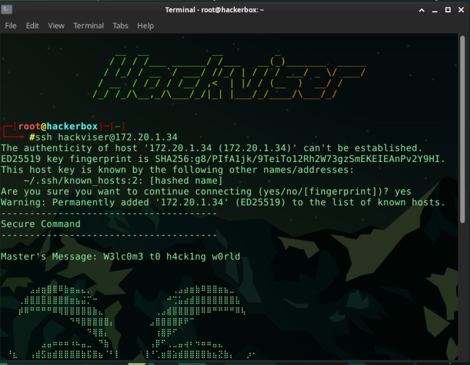
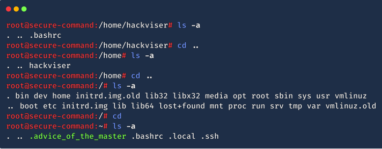
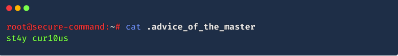

# Secure Command

# 1.Which port(s) are open?
Ans : 22

### Explaination 
SSH of port number is 22.

---

# 2.What is the running service name?
Ans : SSH 

# Explaination
Running service is SSH

---

# 3.What is “Master's Message” when connecting to SSH with hackviser:hackviser credentials?
Ans : W3lc0m3 t0 h4ck1ng w0rld

### Explaination
search using hackviser and can see the answer.

---

# 4.What is the command to change user in Linux?
Ans : su 

### Explaination 
No need search yourself

---

# 5.What's the password for root user?
Ans : root

### Expalaination
Also 

---

# 6.What is the parameter of the ls command that shows hidden files?
Ans : -a

### Explaination
use -a 

---

# 7.What is the master's advice?
Ans : st4y cur10us

### Explaination
search 

---

# Achievement(https://app.hackviser.com/show/YeYintLwin/warmups/secure-command?id=4d6ee3c2da9e46f581f19c85c5b9c8ca)